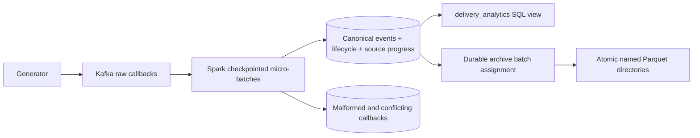

# SignalForge

Java 17 / Kafka / Spark Structured Streaming / PostgreSQL delivery-event pipeline. It reconstructs lifecycle state from reordered evidence, suppresses repeated callback identities, quarantines invalid/conflicting records, and exposes minute-cohort delivery analytics with a recoverable canonical Parquet archive.

## Run

Requires Docker with Compose and Linux containers. On an 8GB laptop, run separately from PayFlow.

```sh
docker compose up -d --build
docker compose run --rm generator
docker compose run --rm inspect
python scripts/smoke.py
docker compose logs -f stream
docker compose down
```

The generator defaults to 10,000 callbacks at 1,000 offered callbacks/sec, with a fixed demo run ID. A repeat intentionally replays the same identities. To generate a new dataset:

```sh
docker compose run --rm -e RUN_ID=experiment-001 -e EVENTS=40000 -e RATE=2000 generator
```

PostgreSQL is accessible at `127.0.0.1:5433`, database/user `signalforge`, development password `local-development-only`. Change `DB_PASSWORD` for shared use. Kafka is internal to Compose. Named volumes retain PostgreSQL, Kafka, Spark checkpoints, and archive data. `docker compose down` preserves them.

## Contract

```json
{"schemaVersion":1,"tenant":"demo","provider":"synthetic","eventId":"e-1","messageId":"m-1","attempt":1,"kind":"DELIVERED","eventTime":"2026-01-01T00:00:02Z","channel":"SMS","market":"IN"}
```

Callback identity is `(tenant, provider, eventId)`. Lifecycle identity is `(tenant, provider, messageId, attempt)`. Allowed states: QUEUED, SENT, DELIVERED, FAILED, EXPIRED. Channel is SMS, EMAIL, or WHATSAPP; identifiers/market are bounded strings. A reused event identity with changed canonical fields is quarantined. Whitespace, JSON property order, and optional padding do not change identity. Conflicting channel/market metadata for one lifecycle is also quarantined.

Terminal evidence dominates intermediate evidence regardless of arrival order. Multiple distinct terminal outcomes produce `CONFLICT`; they are not silently overwritten. There is no time-to-live on the durable identity table, so callbacks later than a Spark watermark still deduplicate. Retention is an explicit future operational policy.

## Architecture



Spark reads Kafka metadata/raw values and writes bounded JDBC chunks per input partition. Each chunk commits canonical facts, lifecycle changes, quarantine, and source progress together. A task failure after a partial chunk commit is safe to replay because canonical identities and quarantine source coordinates are unique. Lifecycle writes are serialized by transaction advisory locks.

The archive claims unarchived canonical events into a durable named batch. Spark writes a staging Parquet directory, then publishes it through an atomic rename on the same local filesystem. On restart, an existing `_SUCCESS` in the final directory is recognized before marking the batch published. PostgreSQL and Parquet are **not one distributed atomic transaction**. Pending archive work is drained before the Spark batch completes. Do not delete checkpoints or archive files independently. The atomic-rename protocol targets a single-host local filesystem, not arbitrary object storage.

`delivery_analytics` groups lifecycles by first event minute, channel, market, and tenant. It is a live SQL view, so late evidence corrects the cohort results. It does not count duplicate callbacks as extra deliveries. These are lifecycle-cohort windows, not per-callback arrival-rate windows. `inspect` prints aggregate samples and Kafka end-offset minus PostgreSQL progress per partition; it is not a Kafka consumer-group committed-offset report.

## Tests

```sh
mvn test
mvn -Pintegration verify
python scripts/smoke.py
```

Domain tests cover commutativity, idempotence, terminal conflicts, schemas, and reordered generator data. PostgreSQL integration tests cover replay after commit, rollback/retry, schema quarantine, and conflicting identities. The Docker smoke test runs Kafka/Spark/PostgreSQL/Parquet together, kills Spark, restarts from its checkpoint, replays callbacks, and checks canonical counts and lag. GitHub Actions runs the integration and smoke suites on Java 17.

## Benchmark targets and reproducibility

**35,000+ events/sec, 100M+ events, and 475GB+ are unverified targets, not recorded achievements.** A fast generator does not establish fast processing. Keep offered rate, Kafka acknowledgements, durable unique-event rate, archive completion, end-to-end lag, and duplicate rate separate.

```sh
docker compose run --rm -e RUN_ID=large-001 -e EVENTS=100000000 -e RATE=35000 -e PADDING=4400 generator
```

This is an opt-in large run; do not run it on the 8GB laptop without sufficient storage and monitoring. 100M / 35k takes at least 47.6 minutes of input. Payload padding changes exact serialized byte counts; use the generator's `payloadBytes`, not an assumed 475GB. Repeated `x` padding compresses strongly, so logical payload bytes are not physical storage consumption or realistic production entropy. The fourth callback in each four-callback group repeats SENT: 100M generated callbacks yield 75M canonical events and 25M lifecycles. The generator uses fixed timestamps and deterministic IDs, making results reproducible and replayable.

The default JDBC implementation performs several round trips per event and is a correctness baseline, **not an implementation already known to sustain 35k/sec**. For each run record the SHA, hardware, limits, payload distribution, raw Kafka counters, database counts, archive counts, disk bytes, timing series, and errors. Fill [run template](benchmarks/run-template.json) with actual evidence. Preserve generator JSON, Spark logs, `inspect` output during and after input, and `docker stats`. Wait for all partitions and archive work to drain before calculating completion throughput.

## Improvement path

1. Profile before tuning: SQL round trips and per-message advisory locks are likely the first bottleneck.
2. Replace row-at-a-time JDBC with COPY into staging plus a set-based transaction that preserves identity conflicts, lifecycle evidence, and source progress.
3. Size Kafka partitions and Spark executor concurrency to available database IOPS; preserve message-key partition affinity.
4. Batch archive publication into larger files and run a separately managed exporter if synchronous draining becomes the bottleneck; retain manifests and restart tests.
5. Partition/retain canonical data only with a documented durable deduplication horizon. Do not silently lose correctness by adding a short watermark.
6. Add entropy-aware generators, richer expected-outcome oracles, tenant authentication at an ingress service, TLS, and production observability before public deployment.

The local Kafka/database network is a trusted lab boundary. There is no public ingestion HTTP API or production multi-tenant authorization layer in this implementation. See [SRS](docs/SRS.md) for the broader design, and [claim map](docs/CLAIMS.md) for exact scope.

[Executed validation](docs/VALIDATION.md) links the passing database and full Docker/Parquet recovery tests, including exact input and canonical-output counts.
